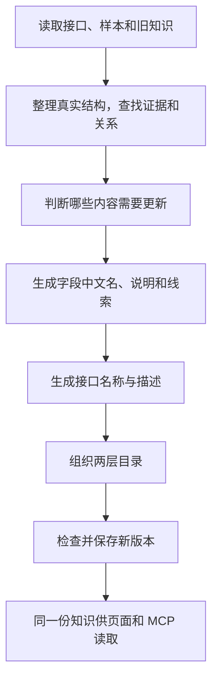

# 优化后的整理流程：依据、处理和产出

状态：目标方案，2026-10-07。 用户进一步明确场景化 MCP 导航是核心，接下来的实施优先级见 [0008 场景导航实施步骤](0008-scenario-navigation-plan.md)。本文描述接下来要实现的完整流程，不表示所有步骤已上线。调查依据见 [整理数据调查](../audits/2026-10-07-curation-quality.md)。

整理的输入是已经保存的接口事实、样本和旧知识，输出是更新后的项目知识：目录、接口名称与说明、字段中文名与说明、关系、依据和变更记录。

这里“生成接口”分两部分：采集/观测确认真实接口的身份与结构；整理为它补充人和 agent 使用的知识。模型不能创造不存在的接口、参数或字段。

## 1. 读取已有资料

**依据：** 已观测的接口列表、各环境的请求/响应结构和真实样本、已保存的页面/操作上下文，以及上次的目录、说明和人工修订。有接口声明或明确人工确认时，也作为有独立来源的材料读取。

**处理：** 按项目、接口、环境归集资料，保留观察时间和原始来源。标出空响应、截断内容、只出现 null 等情况；筛除凭证等不适合作为说明材料的值。原始资料和旧模型解释分开。

**产出：** 每个接口的现有资料，以及上次整理结果。旧模型文字用于比较和参考，不自动成为新业务事实。

## 2. 明确接口和字段的真实结构

**依据：** 观测已经确认的 method、路径模板、项目归属，以及实际请求和响应。

**处理：** 确认接口身份；分别列出路径参数、查询参数、请求体和各响应状态下的字段，记录原始键名、完整路径、父子结构、实际类型和可观察的出现情况。请求与响应同名字段分开识别。

数组中的元素、对象中的子字段及重复树节点都保留真实路径。可以复用重复结构的解释，不能删除具体深度和差异。

**产出：** 接口基本信息和原始字段结构。这些来自采集/观测；缺失的元素结构或业务字段不会由模型补进真实接口合同。

## 3. 从原始资料中寻找证据

**依据：** 字段结构、实际值、同条对象中的字段、页面和顺序信息，以及可能存在的配置响应。

**处理：** 先做可核查的提取与比较：

- 找直接中文标题、字段与标题的对应、同对象的 value/name 配对和明确单位。
- 比较源响应与目标请求的值，结合字段位置、实体、其他一致字段和同一操作的先后。
- 识别列表 ID 到详情 ID、选项 ID/name 到 configId/configName、任务身份到处理请求等对应。
- 过滤 msg、分页大小、排序等通用值造成的弱匹配。
- 区分直接配对、当前样本中的对应和仍需确认的关系。

规则匹配先考虑相关目标和对象，再控制提供给模型的摘要大小。不能先丢弃第 20 个选项，再宣称没有匹配。

**产出：** 有来源、适用范围和确认状态的证据及候选关系。没有可用证据时允许为空；缺少中文配置并不妨碍下一步做基础解释。

## 4. 决定本次更新哪些内容

**依据：** 本次资料与证据、旧知识及其来源、整理规则和解释方式的版本。

**处理：** 新接口生成知识；旧接口出现新字段、新值或新的可用线索时，更新相关内容。另一个接口提供了字典或实体对应，也可以影响旧接口。没有相关变化的结果复用。规则或模型版本升级时，对受影响的生成结果重新评估。

人工修改优先保留。新证据与人工确认冲突时记录冲突，不静默把确认内容变回模型推测。

**产出：** 本次生成/更新/复用的清单，以及每一项为什么需要处理。后续步骤按这份清单执行，不要求用户逐个接口点击生成。

新一轮默认以当前采集资料和已应用的正式知识为基线，不自动继承未应用候选；旧候选保留供查看。续跑则通过指定候选的专用入口，保持同一候选编号和冻结输入，只处理本轮缺口；本轮启动后新增的采集资料由新一轮处理。复用正式生成内容仍需检查证据新鲜度，人工内容继续受保护。

整轮整理不设置累计运行时长上限，持续有处理进展时不会因运行满 2 小时或 6 小时被中止。单次模型请求超时、批次重试预算、无进展超时及用户手动停止仍生效；心跳本身不刷新处理进展时间。

## 5. 生成字段的中文显示名

**依据：** 原始英文名、父级对象、真实接口上下文；存在直接中文标题或人工确认时，优先考虑其来源和适用范围。

**处理：** 有明确对应时采用中文名称；没有时根据英文名和上下文作简短推测。直接来源、人工确认与模型推测分别保留。真实 JSON 键名仍作为调用和定位依据。

例如，createdTime 可推测为“创建时间”；咨询记录的 itemCode 在对应列配置中明确标为“咨询子单号”。别的领域出现 itemCode 时，不直接继承这个中文名称。

**产出：** 原始字段名和中文显示名。例如 `itemCode / 咨询子单号`，并注明中文名来自哪里。

## 6. 生成字段描述

**依据：** 原始结构、中文名称、父级和兄弟字段、观测值、已验证的单位/配置/对应关系和适用场景。

**处理：** 写清字段在当前接口中代表什么，再补充有依据的信息。简短说明和详细补充可以分开保存，避免一个小标题承担所有信息。

可补充的内容包括所属实体、ID 指向什么、单位、当前观察到的值、可适用的值含义、关联来源，以及尚未确认的事项。把模型推测保留为推测。

例如，“预计金额；该页面配置标注单位为万，币种未确认”。模板标记“驳回需要审批意见”时，可以说明模板配置，但不能宣称已经验证后台缺意见必然拒绝。只在全部样本里出现，不足以证明必填。

**产出：** 字段基础说明、额外含义和依据、未知事项。null 样本不能证明以后永远是 null；几个已观察值也不能证明完整枚举。

## 7. 把关系挂到字段和接口上

**依据：** 第 3 步找到的、有原始来源的对应关系。

**处理：** 给关系记录源接口/字段、目标接口/字段、匹配依据、环境、样本、可用的操作顺序和适用范围。模型可把关系讲成人话，但不能通过一句解释把候选关系变成已确认事实。

例如，验证码标识在 uniqueId → id → sliderCaptchaId 之间传递；待办返回的 taskId/processInstanceId 对应到处理请求；该 formKey 的模板 type/name 对应到 actionType/actionName。

再按接口汇总字段关系，形成接口级线索。“这个请求参数可参考哪个接口的哪个返回字段”与“必须先调用那个接口”分别处理。关联字典前，需确认消费字段及业务范围；只因数字相同不能应用映射。

**产出：** 可定位、可核查的字段线索及接口线索。没有发现关系的接口保持空，不追求凑满线索数量。

## 8. 生成接口名称

**依据：** 方法、路径、主要输入/输出、采样页面、明确业务信息和人工命名。字段解释可辅助理解，其中的推测仍须保留其身份。

**处理：** 使用“动作 + 业务对象 + 必要范围”的名称。对管理端和供销云端的同类接口补上必要区分；已有清楚的名称保留。字段解释直接使用真实接口上下文，避免先猜一句用途再把猜测当成所有字段的依据。

例如“管理端处理技术咨询任务”，而不是笼统的“完成任务”。具体身份仍由项目、方法和路径决定，名称用于阅读与检索。

**产出：** 清楚且能区分的接口中文名称。

## 9. 生成接口描述

**依据：** 原始资料、有依据的字段知识、观测场景和关系。

**处理：** 列表中提供简短用途，详情中按需要说明：做什么、主要输入、主要输出、观测到的使用场景、可参考的关联接口、已知限制及未知事项。

例如管理端技术咨询详情可写明：“按咨询主单 ID 查询主单、明细、技术回复和报价信息”。任务处理接口说明“提交当前任务的处理信息”，不自行扩大为结束整条咨询流程。

并非每个接口都需要长文；材料少的接口可以保持简短。若只有成功 HTTP 响应，也不能凭此补出全部错误返回或业务成功规则。

**产出：** 接口简短用途和有意义的详细描述，附来源、范围和不确定事项。

## 10. 生成或更新两层目录

**依据：** 接口真实用途、业务对象、动作及相关场景，以及已有目录、用户分组和人工调整。

**处理：** 在旧结构上提出需要的增量调整。第一层表达业务模块，第二层表达功能分组，再把接口明确归入对应第二层目录。

例如“技术咨询 → 查询与详情 / 发起与校验 / 任务处理 / 报表与进度”。管理端与供销云端的差别可以体现在接口名和标记上，不为了这个差别多造第三层。

分类以接口含义为主，路径为辅助；不用一个路径片段命中所有接口。逐项校验层级不超过两层、业务接口的主要归属唯一、没有无意义空分组。材料不足的项明确待分类/待辨别，不强行归入业务目录。保持旧目录的稳定身份和变更历史。

**产出：** 两层目录、各接口的目录归属和本次目录变更。前端按父子关系逐层展示，搜索展开命中项的祖先目录。

## 11. 检查结果，保存新的知识版本

**依据：** 本次建议结果、原始资料、旧知识和明确的校验规则。

**处理：** 检查引用的接口/字段真实存在、证据能定位、没有把推测包装成确认、没有套错枚举、没有同一范围内互相矛盾的解释，以及目录是否符合两层要求。

检查通过的变更通过 knowledge 轮次保存，记录来源、更新理由和历史。失败的单项保留旧内容并报告失败，已成功内容不因其他项失败丢失。后续读取来自保存结果，MCP 查询不现场重新猜说明。

**产出：** 新版项目知识和本次整理结果：新增、更新、复用、待确认及失败项。能够比较或回滚。

## 最终交付什么

| 产出 | 内容 | 主要依据 |
|---|---|---|
| 两层目录 | 业务模块、子分组、接口归属 | 接口用途与场景、旧目录和人工分组 |
| 接口基本信息 | 方法、路径、参数和响应结构 | 已保存的观测及有效声明 |
| 接口中文名称 | 动作、对象、必要范围 | 真实上下文、明确业务线索及推测 |
| 接口描述 | 简短用途、输入输出、场景、关联与未知项 | 原始资料及有来源的知识 |
| 字段中文名和描述 | 原始键名、中文名、含义、单位、值含义和未知项 | 英文名、结构、直接来源及明确标注的推测 |
| 字段/接口线索 | 取值来源、实体对应、字典候选和参数传递 | 真实样本比较和适用范围 |
| 来源与历史 | 每条知识的依据、更新理由、版本和确认状态 | 本次输入、检查和写入记录 |

人和未来 MCP agent 使用同一份保存的知识。每条知识要让读者看得出从哪里来、属于事实还是推测、适用于哪里、何时更新。

持续成长发生在重复执行这套流程：只认识英文名时作基础推测；后来发现明确中文标题、值含义或跨接口对应，就修正或补充旧知识；没有相关变化则复用。成长以已保存的新证据为前提，整理无法找回采集/观测未保留的新值。

### 2026-10-09 模型并发与参数验证

字段工作池直接使用配置的工作位（默认 8），接口说明默认 4；所有调用共用模型适配器的一个准入预算（默认 8）。本地排队与请求耗时分开记录。单次慢响应、150 秒请求超时和字段校验重试不降低全局并发；超时批次仍由执行器拆小、保留已保存内容、仅重试缺口。

只有 HTTP 429/503 触发共享预算退让。同一批在途请求只触发一次降档，持续过载延长 30 秒恢复冷却期；冷却后收集一个当前容量窗口的成功请求，再增加一个工作位。取消仍归还或回收准入许可，不持有许可等待重试。

`NEXOFOLIO_MODEL_THINKING` 支持 `provider`（不发送扩展参数）、`low`、`high`、`max`、`disabled`；`NEXOFOLIO_MODEL_JSON_OUTPUT=true` 显式请求 JSON。默认保留通用兼容行为，特定网关需先验证。回复明确标记截断或异常结束时不接受结果；JSON 可解析不等于业务含义正确，仍执行字段 key、完整性、来源和观测值保存校验。

`model_benchmark_tests` 和 `model_stage_benchmark_tests` 为显式忽略的付费测试：前者需 `BENCHMARK_ALLOW_PAID=36`，后者需 `=9`，均需要只读数据库连接和新的私有输出目录；仅生成内存命令，不应用候选。实测对比与语义检查见 `docs/audits/2026-10-09-model-comparison.json`。小样本吞吐不作为整轮完成时间保证。

Flash 思考档位补测使用 `model_effort_benchmark_tests`：对原始 15 组输入核对提示词哈希后再请求模型，high 先覆盖全部样本，max 只测选定难例。`experiments/run-effort-benchmark.py` 从当前本地进程私下读取连接配置，仅运行指定次数的只读实验；输出目录必须新建，禁止覆盖旧结果。`experiments/summarize-effort-benchmark.py` 汇总耗时、失败与重试、来源/观测值保留以及候选未变校验，不输出原始报文。结果见 `docs/audits/2026-10-09-flash-effort-comparison.json`；这次实验没有变更正式模型，也没有实现自动语义检测或 high/max 分流。

### 2026-10-09 接口说明限流恢复

接口说明按接口最多尝试 4 次，失败不再取消并重启整个阶段。429 后对该接口等待 30/60/120 秒；其他已发出的成功结果继续保存，重试耗尽后停止分配新接口并收齐在途结果，候选保留供续跑。格式缺口只重试当前接口，401/403 等永久拒绝不重复请求。

共享模型准入预算在 429/503 后暂停所有新请求至少 30 秒，并解析 `Retry-After` 的秒数或 HTTP 日期；有效的更长等待也会遵守。并发退让同时参考实际在途请求数，使全局上限 8、实际仅 4 个接口说明请求时也能降到 2。等待不持有模型许可，取消与缩容债务回收均有模拟测试；普通超时仍只影响对应批次，不降低全局并发。日志只补充 HTTP 状态和重试延迟等数字，不记录上游错误体。持续限流仍有重试和无进展保护，不保证网关配额必定恢复。

本轮故障与保护校验记录见 `docs/audits/2026-10-09-rate-limit-recovery.json`；没有为验证修复而额外调用真实模型，也没有自动续跑或应用候选。
